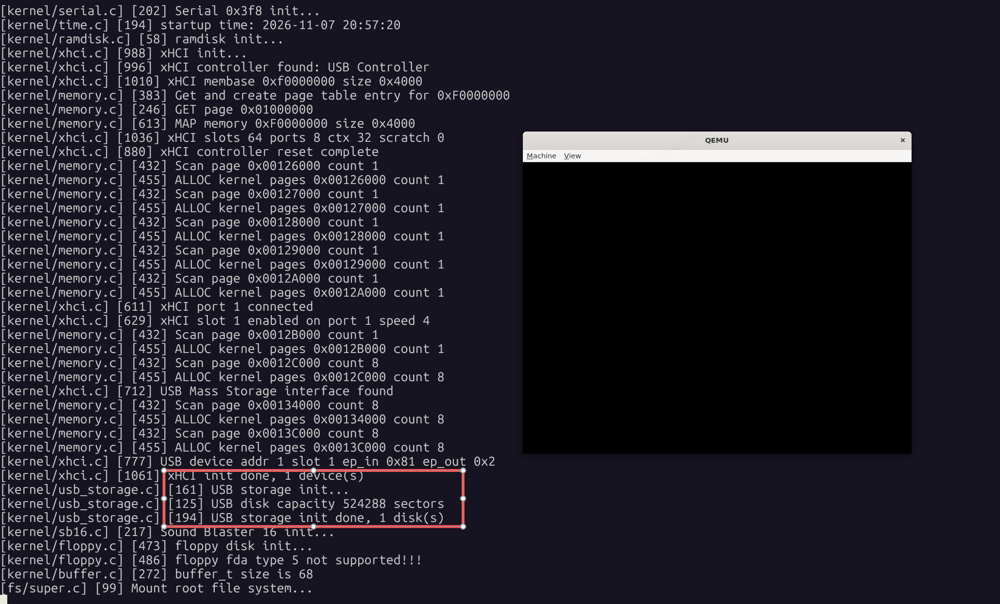

执行`make qemu-usb-xhci`，使用qemu模拟`xhci与usb-storage`，应看到如下图的串口日志输出



源码位置：https://github.com/znyinyyniu/onix/tree/usb-explain

# USB 存储设备驱动

`usb_storage.c` 把已经枚举好的 USB 大容量存储设备，做成可以按扇区读写的磁盘。找控制器、复位端口和解析描述符都在 [xHCI 主机控制器驱动](182%20xHCI主机控制器驱动.md) 里完成。本文件在批量端点上跑 USB Mass Storage 的 Bulk-Only 传输，把 SCSI 命令交给 U 盘。

SCSI（Small Computer System Interface，小型计算机系统接口）在这里指的是一套磁盘命令，原来用在 SCSI 总线的硬盘、光盘和磁带上。U 盘的电气接口是 USB，Bulk-Only 存储设备约定主机仍用这套命令描述“读哪一块、写哪一块”。接口描述符里的子类 `0x06` 就是这个意思：设备按 SCSI 命令集理解主机发来的字节，称为 SCSI 透明命令集。光盘驱动里的 ATAPI 也是同一做法，把 SCSI 命令封装后交给另一种总线。

一条 SCSI 命令是一段很短的字节数组，叫做命令描述块（Command Descriptor Block，CDB）。第 0 字节是操作码，后面是参数。本驱动使用 10 字节的 CDB，放进 CBW 的 `cb` 字段，`cb_len` 填 10。命令里只有操作说明，扇区数据在 BOT 的数据阶段另外传输。

以读扇区为例，`usb_storage_read_sectors` 填出的就是这样一条命令：

```c++
#define SCSI_READ10 0x28

u8 cb[16];
memset(cb, 0, sizeof(cb));
cb[0] = SCSI_READ10;             // 操作码：READ (10)
cb[2] = (lba >> 24) & 0xFF;      // 起始 LBA，大端，占字节 2..5
cb[3] = (lba >> 16) & 0xFF;
cb[4] = (lba >> 8) & 0xFF;
cb[5] = lba & 0xFF;
cb[7] = (count >> 8) & 0xFF;     // 扇区个数，大端，占字节 7..8
cb[8] = count & 0xFF;
```

本文件用到三条，操作码都定义在 `src/kernel/usb_storage.c`：

| 操作码 | 命令 | 作用 |
| --- | --- | --- |
| `0x25` | `READ CAPACITY (10)` | 询问最后一个 LBA 和每块字节数 |
| `0x28` | `READ (10)` | 从指定 LBA 读若干扇区 |
| `0x2A` | `WRITE (10)` | 向指定 LBA 写若干扇区 |

```c++
#define SCSI_READ_CAPACITY10 0x25
#define SCSI_READ10 0x28
#define SCSI_WRITE10 0x2A
```

内核在 `ONIX_USB_BOOT` 下按这个顺序初始化，见 `src/kernel/init.c`：

```c++
#ifdef ONIX_USB_BOOT
    xhci_init();
    usb_storage_init();
#else
    ide_init(); // 初始化 IDE 设备
#endif
```

```txt
xhci_init()            枚举设备，标出 Bulk-Only 大容量存储
        |
        v
usb_storage_init()     读容量，填 usb_disk_t
        |
        v
usb_storage_read_sectors / usb_storage_write_sectors
                       按 LBA 读写扇区
```

`xhci_init` 解析接口描述符时，用三个字段认出 U 盘。常量定义在 `src/include/onix/xhci.h`：

```c++
// USB Mass Storage Bulk-Only interface
#define USB_CLASS_MASS_STORAGE 0x08
#define USB_SUBCLASS_SCSI 0x06
#define USB_PROTO_BOT 0x50
```

类 `0x08` 是 Mass Storage，子类 `0x06` 是 SCSI 透明命令集，协议 `0x50` 是 Bulk-Only Transport。`src/kernel/xhci.c` 命中后把 `mass_storage` 置真，并记下批量 IN、批量 OUT 两个端点：

```c++
if (iface->class == USB_CLASS_MASS_STORAGE &&
    iface->subclass == USB_SUBCLASS_SCSI &&
    iface->protocol == USB_PROTO_BOT)
{
    found_ms = true;
    USBLOG("USB Mass Storage interface found\n");
}
// ... 同一接口下收集传输类型为批量（attr 低 2 位等于 2）的端点
if (ep_addr & 0x80)
{
    ep_in = ep_addr;
    ep_in_mps = ep->max_packet;
    ep_in_id = ep_id;
}
else
{
    ep_out = ep_addr;
    ep_out_mps = ep->max_packet;
    ep_out_id = ep_id;
}

xdev->ep_in = ep_in;
xdev->ep_out = ep_out;
xdev->ep_in_mps = ep_in_mps;
xdev->ep_out_mps = ep_out_mps;
xdev->mass_storage = true;
```

存储驱动只处理带这个标志的设备。

# Bulk-Only 传输

U 盘的命令和数据都走批量端点。一次命令固定成三步，合称 BOT（Bulk-Only Transport）。这三步就是 `bot_command` 的主体，见 `src/kernel/usb_storage.c`：

```txt
主机                          设备
  |  1. CBW   批量 OUT          |
  | --------------------------> |  命令块：做什么、数据有多长、方向
  |                             |
  |  2. Data  批量 IN 或 OUT    |
  | <-------------------------> |  有数据才走这一步；长度为 0 则跳过
  |                             |
  |  3. CSW   批量 IN           |
  | <-------------------------- |  状态块：签名、标签、剩余字节、成败
```

```c++
// 1. CBW：31 字节，永远走批量 OUT
if (xhci_bulk_out(xdev, cbw, sizeof(*cbw)) < EOK)
{
    LOGK("BOT CBW bulk out failed\n");
    return -EIO;
}

// 2. Data：data_len 为 0 时整段跳过
if (data_len > 0)
{
    if (in)
    {
        if (xhci_bulk_in(xdev, data, data_len) < EOK)
        {
            LOGK("BOT data bulk in failed\n");
            return -EIO;
        }
    }
    else
    {
        if (xhci_bulk_out(xdev, data, data_len) < EOK)
        {
            LOGK("BOT data bulk out failed\n");
            return -EIO;
        }
    }
}

// 3. CSW：13 字节，永远走批量 IN
bot_csw_t *csw = &bot_csw_buf;
if (xhci_bulk_in(xdev, csw, sizeof(*csw)) < EOK)
{
    LOGK("BOT CSW bulk in failed\n");
    return -EIO;
}
```

数据阶段的方向由参数 `in` 决定：读盘为真，走批量 IN；写盘为假，走批量 OUT。主机给每次命令分配一个 `tag`，设备在 CSW 里原样带回，驱动用它把状态和对应的命令对上。

# 数据结构

CBW 对应 `bot_cbw_t`。字段按 USB 小端存放，结构体加了 `_packed`，发出去正好 31 字节。

```c++
#define CBW_SIGNATURE 0x43425355
#define CSW_SIGNATURE 0x53425355

typedef struct bot_cbw_t
{
    u32 signature; // 固定 0x43425355，线上字节是 USBC
    u32 tag;       // 本次命令的标签，从 1 递增
    u32 data_len;  // 数据阶段字节数，0 表示没有数据阶段
    u8 flags;      // bit7 为 1 表示数据 IN，为 0 表示数据 OUT
    u8 lun;        // 逻辑单元号，当前固定为 0
    u8 cb_len;     // 后面 SCSI 命令的有效长度，本驱动用 10
    u8 cb[16];     // SCSI 命令块，不足 16 字节的部分填 0
} _packed bot_cbw_t;
```

CSW 对应 `bot_csw_t`，13 字节。`status` 为 0 表示成功，1 表示命令失败，2 表示阶段错误。

```c++
typedef struct bot_csw_t
{
    u32 signature; // 必须是 0x53425355，线上字节是 USBS
    u32 tag;       // 必须等于本次 CBW 的 tag
    u32 residue;   // 声明长度和实际传输长度的差值
    u8 status;     // 0 成功，1 命令失败，2 阶段错误
} _packed bot_csw_t;
```

`READ CAPACITY (10)` 的返回数据是 8 字节，对应 `read_capacity10_t`。SCSI 的多字节字段是大端，读回来之后用 `ntohl` 转成主机字节序。块数等于最后一个 LBA 加 1。

```c++
typedef struct read_capacity10_t
{
    u32 lba;       // 最后一个 LBA，大端
    u32 block_len; // 每块字节数，大端
} _packed read_capacity10_t;

u32 blocks = ntohl(cap->lba) + 1;
u32 block_len = ntohl(cap->block_len);
```

枚举到的磁盘放在 `usb_disk_t` 里，定义在 `src/include/onix/usb.h`：

```c++
#define USB_DISK_NR 1
#define USB_PART_NR GPT_MAX_ENTRIES

typedef struct usb_disk_t
{
    char name[16];           // 设备名，形如 usb0
    xhci_device_t *xdev;     // xHCI 枚举结果，里面有槽位和批量端点
    u32 total_lba;           // 扇区总数
    u32 sector_size;         // 扇区大小，当前只接受 512
    usb_part_t parts[USB_PART_NR]; // 分区表，留给后续 GPT 安装使用
} usb_disk_t;
```

全局只有 `USB_DISK_NR` 个槽位。CBW、CSW 和容量缓冲区也是文件内的静态变量。`xhci_bulk_in` / `xhci_bulk_out` 会把缓冲区的物理地址写进 TRB，由控制器 DMA 读写，所以这三块内存一直有效，放在静态区。

```c++
static usb_disk_t usb_disks[USB_DISK_NR];
static u32 bot_tag = 1;
static bot_cbw_t bot_cbw_buf;
static bot_csw_t bot_csw_buf;
static read_capacity10_t bot_cap_buf;
```

# 发送一条命令

`bot_command` 把上面的三步收成一次调用。参数是 SCSI 命令、数据缓冲区、数据长度，以及方向 `in`。

```c++
static err_t bot_command(xhci_device_t *xdev, u8 *cb, u8 cb_len, void *data, u32 data_len, bool in)
{
    bot_cbw_t *cbw = &bot_cbw_buf;
    memset(cbw, 0, sizeof(*cbw));
    cbw->signature = CBW_SIGNATURE;
    cbw->tag = bot_tag;
    cbw->data_len = data_len;
    cbw->flags = in ? 0x80 : 0;
    cbw->lun = 0;
    cbw->cb_len = cb_len;
    memcpy(cbw->cb, cb, cb_len);

    if (xhci_bulk_out(xdev, cbw, sizeof(*cbw)) < EOK)
    {
        LOGK("BOT CBW bulk out failed\n");
        return -EIO;
    }

    if (data_len > 0)
    {
        if (in)
        {
            if (xhci_bulk_in(xdev, data, data_len) < EOK)
            {
                LOGK("BOT data bulk in failed\n");
                return -EIO;
            }
        }
        else
        {
            if (xhci_bulk_out(xdev, data, data_len) < EOK)
            {
                LOGK("BOT data bulk out failed\n");
                return -EIO;
            }
        }
    }

    bot_csw_t *csw = &bot_csw_buf;
    if (xhci_bulk_in(xdev, csw, sizeof(*csw)) < EOK)
    {
        LOGK("BOT CSW bulk in failed\n");
        return -EIO;
    }

    if (csw->signature != CSW_SIGNATURE || csw->tag != bot_tag || csw->status != 0)
    {
        LOGK("BOT CSW error sig 0x%x tag %d status %d\n", csw->signature, csw->tag, csw->status);
        return -EIO;
    }

    bot_tag++;
    return EOK;
}
```

填 CBW 时，`flags` 在读操作写 `0x80`，写操作写 `0`。LUN 固定 0，SCSI 命令复制进 `cb`。CSW 回来后核对三项：签名是 `USBS`，标签等于本次 `bot_tag`，`status` 为 0。任一不符就返回 `-EIO`。通过后 `bot_tag` 加 1。任一步的批量传输失败同样返回 `-EIO`，驱动不做复位恢复。

# 三条 SCSI 命令

操作码定义如下。命令块前 10 字节有效，`cb_len` 传 10。多字节的 LBA 和传输长度按大端写入。

```c++
#define SCSI_READ_CAPACITY10 0x25
#define SCSI_READ10 0x28
#define SCSI_WRITE10 0x2A
```

`READ CAPACITY (10)` 没有参数，数据阶段读回 8 字节。扇区长度不是 `SECTOR_SIZE`（512）时拒绝这块盘，上层块设备按 512 字节扇区工作。

```c++
static err_t usb_storage_read_capacity(usb_disk_t *disk)
{
    u8 cb[16];
    read_capacity10_t *cap = &bot_cap_buf;

    memset(cb, 0, sizeof(cb));
    cb[0] = SCSI_READ_CAPACITY10;

    if (bot_command(disk->xdev, cb, 10, cap, sizeof(*cap), true) < EOK)
        return -EIO;

    u32 blocks = ntohl(cap->lba) + 1;
    u32 block_len = ntohl(cap->block_len);

    if (block_len != SECTOR_SIZE)
    {
        LOGK("USB disk sector size %d unsupported\n", block_len);
        return -EIO;
    }

    disk->total_lba = blocks;
    disk->sector_size = block_len;
    USBLOG("USB disk capacity %d sectors\n", disk->total_lba);
    return EOK;
}
```

`READ (10)` 的命令块布局：

```txt
字节 0      操作码 0x28
字节 2..5   起始 LBA，大端
字节 7..8   扇区个数，大端
```

`usb_storage_read_sectors` 按这个布局填命令，数据长度是 `count * sector_size`，方向为 IN：

```c++
err_t usb_storage_read_sectors(usb_disk_t *disk, void *buf, u8 count, idx_t lba)
{
    u8 cb[16];
    memset(cb, 0, sizeof(cb));
    cb[0] = SCSI_READ10;
    cb[2] = (lba >> 24) & 0xFF;
    cb[3] = (lba >> 16) & 0xFF;
    cb[4] = (lba >> 8) & 0xFF;
    cb[5] = lba & 0xFF;
    cb[7] = (count >> 8) & 0xFF;
    cb[8] = count & 0xFF;

    return bot_command(disk->xdev, cb, 10, buf, count * disk->sector_size, true);
}
```

`WRITE (10)` 的布局与读相同，操作码换成 `0x2A`，`bot_command` 的方向参数为 `false`：

```c++
err_t usb_storage_write_sectors(usb_disk_t *disk, void *buf, u8 count, idx_t lba)
{
    u8 cb[16];
    memset(cb, 0, sizeof(cb));
    cb[0] = SCSI_WRITE10;
    cb[2] = (lba >> 24) & 0xFF;
    cb[3] = (lba >> 16) & 0xFF;
    cb[4] = (lba >> 8) & 0xFF;
    cb[5] = lba & 0xFF;
    cb[7] = (count >> 8) & 0xFF;
    cb[8] = count & 0xFF;

    return bot_command(disk->xdev, cb, 10, buf, count * disk->sector_size, false);
}
```

`count` 的类型是 `u8`，单次调用最多 255 个扇区。LBA 放在 32 位大端字段里，寻址范围是 2TiB 以内的 512 字节扇区。

# 初始化

`usb_storage_init` 在 `xhci_init` 之后调用。

```c++
void usb_storage_init(void)
{
    USBLOG("USB storage init...\n");

    int count = xhci_device_count();
    if (!count)
    {
        USBLOG("No USB devices found\n");
        return;
    }

    int disk_idx = 0;
    for (int i = 0; i < count && disk_idx < USB_DISK_NR; i++)
    {
        xhci_device_t *xdev = xhci_get_device(i);
        if (!xdev || !xdev->mass_storage)
            continue;

        usb_disk_t *disk = &usb_disks[disk_idx];
        memset(disk, 0, sizeof(*disk));
        sprintf(disk->name, "usb%d", disk_idx);
        disk->xdev = xdev;
        disk->sector_size = SECTOR_SIZE;

        if (usb_storage_read_capacity(disk) < EOK)
        {
            USBLOG("USB disk %d read capacity failed\n", disk_idx);
            continue;
        }

        // usb_gpt_install(disk);
        disk_idx++;
    }

    // usb_install();
    USBLOG("USB storage init done, %d disk(s)\n", disk_idx);
}
```

1. `xhci_device_count` 为 0 时直接返回。
2. 逐个取出 `xhci_device_t`，`mass_storage` 为假就 `continue`。
3. 取一个 `usb_disk_t`，名字写成 `usb0`、`usb1`，挂上 `xdev`，扇区大小先记成 512。
4. 调用 `usb_storage_read_capacity`。失败则丢弃这块盘，继续看下一台设备。
5. 成功后 `disk_idx` 加 1，直到设备扫完或达到 `USB_DISK_NR`。

容量读成功后，磁盘对象保存在 `usb_disks` 里。`usb_gpt_install` 和 `usb_install` 仍是注释，分区安装和块设备注册还没有接上，初始化结束时只有容量。

# 和 xHCI 的边界

存储驱动看见的设备是 `xhci_device_t`，定义在 `src/include/onix/xhci.h`。真正用到的是槽位号和两个批量端点：

```c++
typedef struct xhci_device_t
{
    u8 slot;           // xHCI 槽位号，Enable Slot 分配，用于索引上下文和门铃
    u8 address;        // USB 设备地址，Address Device 后由控制器分配
    u8 port;           // 根集线器端口号（从 1 起）
    u8 speed;          // 端口速率：1 Full、2 Low、3 High、4 Super
    u16 ep0_mps;       // 端点 0 最大包长
    u8 ep_in;          // 批量 IN 端点地址（含方向位）
    u8 ep_out;         // 批量 OUT 端点地址
    u16 ep_in_mps;     // 批量 IN 端点最大包长
    u16 ep_out_mps;    // 批量 OUT 端点最大包长
    bool mass_storage; // 是否为 Bulk-Only 大容量存储设备
} xhci_device_t;
```

收发由 `src/kernel/xhci.c` 的两个函数完成。它们按端点地址算出端点号，再在对应 Transfer Ring 上放一个 Normal TRB，把缓冲区物理地址交给控制器 DMA：

```c++
static err_t xhci_do_bulk(xhci_t *hc, xhci_device_t *dev, u8 ep_idx, void *buf, u32 len, bool in)
{
    xhci_trb_t *trb = xhci_next_xfer(hc, dev->slot, ep_idx);
    memset(trb, 0, sizeof(*trb));
    trb->control = trb_type(TRB_CYCLE | TRB_IOC, TRB_TYPE_NORMAL);
    if (hc->ep_cycle[dev->slot][ep_idx])
        trb->control |= TRB_CYCLE;
    if (in)
        trb->control |= TRB_DIR_IN;
    trb->status = TRB_LEN(len);
    trb_set_addr(trb, get_paddr((u32)buf));
    u32 trb_idx = hc->ep_enqueue[dev->slot][ep_idx] - 1;
    bool cycle = (trb->control & TRB_CYCLE) != 0;
    xhci_set_ep_dequeue(hc, dev->slot, ep_idx, trb_idx, cycle);
    xhci_post_xfer(hc, dev->slot, ep_idx);
    return xhci_wait_event(hc, TRB_TYPE_EVT_TRANSFER, NULL, NULL, 30000);
}

err_t xhci_bulk_in(xhci_device_t *dev, void *buf, u32 len)
{
    u8 ep_idx = xhci_ep_id(dev->ep_in);
    return xhci_do_bulk(&xhci, dev, ep_idx, buf, len, true);
}

err_t xhci_bulk_out(xhci_device_t *dev, void *buf, u32 len)
{
    u8 ep_idx = xhci_ep_id(dev->ep_out);
    return xhci_do_bulk(&xhci, dev, ep_idx, buf, len, false);
}
```

`xhci_bulk_out` 走批量 OUT 端点，方向为主机到设备，用来发 CBW 和写盘数据。`xhci_bulk_in` 走批量 IN 端点，方向为设备到主机，用来收读盘数据和 CSW。门铃、事件环和完成等待留在 xHCI 里。存储驱动按 CBW、数据、CSW 的顺序调用这两次或三次传输。
