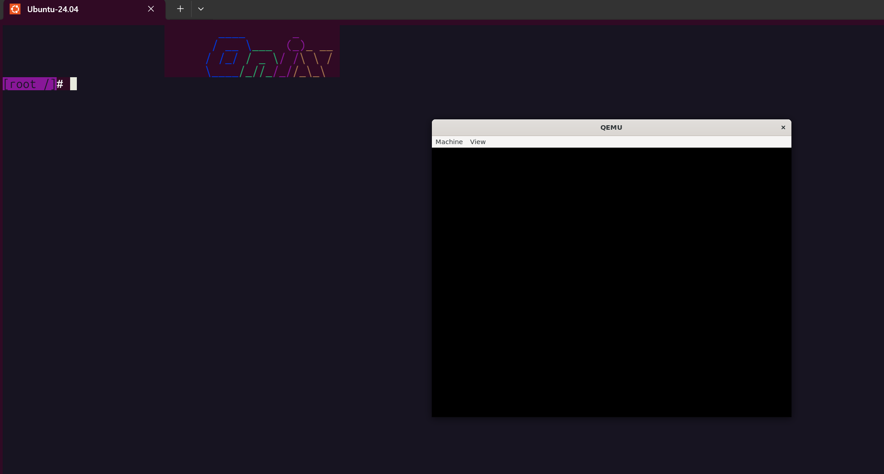

执行`make qemu-usb-xhci`，使用qemu模拟`xhci与usb-storage`，应看到如下图的串口显示



源码位置：https://github.com/znyinyyniu/onix/tree/usb-explain

# GPT 分区与 USB 根文件系统挂载

本文说明 U 盘从「整盘扇区读写」走到「按分区注册块设备、挂载根文件系统」的路径，对应源码：

| 文件 | 职责 |
| --- | --- |
| `src/kernel/gpt.c` / `src/include/onix/gpt.h` | 解析 GPT 头与分区表项 |
| `src/kernel/usb.c` / `src/include/onix/usb.h` | 安装 U 盘整盘设备、分区设备 |
| `src/fs/super.c` | 在 `ONIX_USB_BOOT` 下把根挂到 U 盘第 2 个分区 |

前置依赖见 [184 USB存储设备驱动](184%20USB存储设备驱动.md)：`usb_storage_init` 读出容量后调用 `usb_gpt_install`，全部盘处理完再调用 `usb_install`。

初始化顺序（`ONIX_USB_BOOT`）：

```txt
xhci_init()
    |
    v
usb_storage_init()
    |-- 读容量，填 usb_disk_t
    |-- usb_gpt_install(disk)   解析 GPT，填 usb_part_t
    |-- usb_install()           注册 DEV_USB_DISK / DEV_USB_PART
    v
super_init() -> mount_root()    选第 2 个 USB 分区挂根
```

镜像布局由 `src/utils/usb-efi.mk` 生成：GPT 盘上第 1 分区是 EFI 系统分区（FAT），第 2 分区是 Minix 根文件系统。

---

## 1. GPT 分区表

GPT（GUID Partition Table）把分区元数据放在磁盘固定 LBA 上，本内核只读主表，不做 CRC 校验与备份表恢复。

### 磁盘布局（本实现关心的部分）

| LBA | 内容 |
| --- | --- |
| 0 | 保护性 MBR（本代码不解析） |
| 1 | GPT Header |
| `header->partition_lba`（通常为 2） | 分区表项数组 |

### 结构体

头与表项定义在 `src/include/onix/gpt.h`：

```c
typedef struct gpt_header_t
{
    char signature[8];       // "EFI PART"
    u32 revision;
    u32 header_size;         // 至少 92
    u32 crc32;
    u32 reserved;
    u64 my_lba;
    u64 backup_lba;
    u64 first_usable;
    u64 last_usable;
    u8 disk_guid[16];
    u64 partition_lba;       // 分区表起始 LBA
    u32 partition_count;
    u32 partition_entry_size;
    u32 partition_crc32;
} _packed gpt_header_t;

typedef struct gpt_entry_t
{
    u8 type_guid[16];        // 全 0 表示空槽
    u8 unique_guid[16];
    u64 first_lba;
    u64 last_lba;
    u64 attributes;
    u16 name[36];            // UTF-16LE 分区名
} _packed gpt_entry_t;
```

解析结果落到更小的 `gpt_part_info_t`：分区在表中的下标、起止 LBA、扇区数、以及从 UTF-16 截出的 ASCII 名。

### 校验：`gpt_validate_header`

```c
bool gpt_validate_header(gpt_header_t *header)
{
    if (memcmp(header->signature, GPT_SIGNATURE, 8) != 0)
        return false;
    if (header->header_size < 92)
        return false;
    if (header->partition_entry_size < sizeof(gpt_entry_t))
        return false;
    if (header->partition_count == 0)
        return false;
    return true;
}
```

签名必须是 `"EFI PART"`；头长度、表项大小、分区个数做下限检查。表项数上限为 `GPT_MAX_ENTRIES`（8）。

### 读取：`gpt_read_partitions`

接口通过回调读扇区，不绑定具体总线：

```c
typedef int (*gpt_block_read_t)(void *disk, void *buf, u8 count, idx_t lba);

int gpt_read_partitions(void *disk, gpt_block_read_t read,
                        gpt_part_info_t *parts, int max_parts);
```

流程：

1. 读 LBA 1 得到 GPT Header，校验失败则返回 0。
2. 按 `partition_count` 与 `partition_entry_size` 计算表占用扇区数，从 `partition_lba` 起整表读入。
3. 遍历表项：`type_guid` 全 0 视为空，跳过。
4. 对有效项填入 `first_lba` / `last_lba` / `sector_count = last - first + 1`，并把 UTF-16 名中的 ASCII 字符拷到 `name`。
5. 返回找到的分区个数；失败或不是 GPT 盘时返回 0。

U 盘侧传入的读回调是：

```c
static int usb_disk_block_read(void *disk, void *buf, u8 count, idx_t lba)
{
    return usb_storage_read_sectors((usb_disk_t *)disk, buf, count, lba);
}
```

---

## 2. 安装 U 盘设备与 U 盘分区设备

相关结构在 `src/include/onix/usb.h`：

```c
#define USB_DISK_NR 1
#define USB_PART_NR GPT_MAX_ENTRIES   // 8

typedef struct usb_part_t
{
    char name[16];            // 如 usb0p1、usb0p2
    struct usb_disk_t *disk;
    u32 start;                // 分区起始 LBA（相对整盘）
    u32 count;                // 扇区数
    u32 index;                // GPT 表项下标（从 0 起）
} usb_part_t;

typedef struct usb_disk_t
{
    char name[16];            // 如 usb0
    xhci_device_t *xdev;
    u32 total_lba;
    u32 sector_size;
    usb_part_t parts[USB_PART_NR];
} usb_disk_t;
```

### 2.1 解析分区：`usb_gpt_install`

`usb_storage_init` 在读容量成功后调用：

```c
void usb_gpt_install(usb_disk_t *disk)
{
    gpt_part_info_t parts[USB_PART_NR];
    int count = gpt_read_partitions(disk, usb_disk_block_read, parts, USB_PART_NR);
    if (!count)
    {
        USBLOG("USB disk %s: no GPT partitions\n", disk->name);
        return;
    }

    for (int i = 0; i < count && i < USB_PART_NR; i++)
    {
        usb_part_t *part = &disk->parts[i];
        gpt_part_info_t *info = &parts[i];
        sprintf(part->name, "%sp%d", disk->name, info->index + 1);
        part->disk = disk;
        part->start = (u32)info->first_lba;
        part->count = info->sector_count;
        part->index = info->index;
    }

    if (usb_disk_count < USB_DISK_NR)
        usb_disk_list[usb_disk_count++] = disk;
}
```

要点：

- 分区名按 Linux 习惯：整盘 `usb0`，第 1 个有效 GPT 项（表下标 0）为 `usb0p1`，下标 1 为 `usb0p2`。
- 分区读写相对本分区 LBA 0；真正访问整盘时加上 `part->start`。
- 只有解析出至少一个分区的盘才会进入 `usb_disk_list`，供后续 `usb_install` 使用。

分区相对读写：

```c
int usb_part_read(usb_part_t *part, void *buf, u8 count, idx_t lba)
{
    return usb_disk_read(part->disk, buf, count, part->start + lba);
}

int usb_part_write(usb_part_t *part, void *buf, u8 count, idx_t lba)
{
    return usb_disk_write(part->disk, buf, count, part->start + lba);
}
```

### 2.2 注册块设备：`usb_install`

```c
void usb_install(void)
{
    for (int d = 0; d < usb_disk_count; d++)
    {
        usb_disk_t *disk = usb_disk_list[d];
        if (!disk->total_lba)
            continue;

        dev_t pdev = device_install(
            DEV_BLOCK, DEV_USB_DISK, disk, disk->name, 0,
            usb_disk_ioctl, usb_disk_read, usb_disk_write);

        for (int i = 0; i < USB_PART_NR; i++)
        {
            usb_part_t *part = &disk->parts[i];
            if (!part->count)
                continue;
            device_install(
                DEV_BLOCK, DEV_USB_PART, part, part->name, pdev,
                usb_part_ioctl, usb_part_read, usb_part_write);
        }
    }
}
```

| 设备类型 | 子类型 | 私有指针 | 名称示例 | parent |
| --- | --- | --- | --- | --- |
| `DEV_BLOCK` | `DEV_USB_DISK` | `usb_disk_t *` | `usb0` | 0 |
| `DEV_BLOCK` | `DEV_USB_PART` | `usb_part_t *` | `usb0p1` / `usb0p2` | 整盘的 `pdev` |

`ioctl` 对整盘与分区分别回答扇区起点、扇区数、扇区大小：

| 命令 | 整盘 | 分区 |
| --- | --- | --- |
| `DEV_CMD_SECTOR_START` | 0 | `part->start` |
| `DEV_CMD_SECTOR_COUNT` | `disk->total_lba` | `part->count` |
| `DEV_CMD_SECTOR_SIZE` | `disk->sector_size` | `part->disk->sector_size` |

`device_find(subtype, idx)` 按子类型在设备表中顺序编号。对当前镜像，先安装的分区是 `usb0p1`（idx 0），再安装 `usb0p2`（idx 1）。

---

## 3. 将根文件系统挂载到 U 盘第 2 个分区

`super_init` 末尾调用 `mount_root`。在定义了 `ONIX_USB_BOOT` 时（见 `src/makefile` 中 `CFLAGS+= -DONIX_USB_BOOT`），根设备选 USB 分区而不是 IDE：

```c
static void mount_root()
{
    LOGK("Mount root file system...\n");

    device_t *device = NULL;
#ifdef ONIX_USB_BOOT
    device = device_find(DEV_USB_PART, 1);
    if (!device)
        device = device_find(DEV_USB_PART, 0);
    if (!device)
        printk("mount_root: no DEV_USB_PART found (USB enum failed)\n");
#else
    device = device_find(DEV_IDE_PART, 0);
    if (!device)
        device = device_find(DEV_IDE_CD, 0);
#endif
    if (!device)
        panic("Cann't find available device.");

    root = read_super(device->dev);
    assert(root);

    root->imount = root->iroot;
    root->imount->count++;
    root->iroot->mount = device->dev;
}
```

### 为何是第 2 个分区

`usb-efi.mk` 建盘时：

1. `parted ... mklabel gpt`
2. 第 1 分区：`ESP`，FAT，约 1MiB～33MiB，放 GRUB EFI 与 `kernel.bin`
3. 第 2 分区：剩余空间，`mkfs.minix`，放 `/bin`、`/etc` 等根目录内容

因此：

- `device_find(DEV_USB_PART, 1)` → 注册顺序中的第二个分区 → `usb0p2` → Minix 根
- 若只有一个分区或第 2 个未注册成功，则退回 `DEV_USB_PART, 0`

### 挂载过程

1. `read_super(device->dev)`：若该设备尚无超级块，则依次尝试已注册的文件系统 `op->super`（含 Minix），成功则得到 `root`。
2. `root->imount = root->iroot`：把根 inode 同时当作挂载点。
3. `root->iroot->mount = device->dev`：标记该 inode 挂在此块设备上。

之后路径解析从 `root` 出发，块读写落到 `usb0p2` 的相对 LBA，再经 `usb_part_read` / `usb_part_write` 映射到整盘绝对 LBA。

### 与非 USB 启动的对比

| 宏 | 根设备查找顺序 |
| --- | --- |
| `ONIX_USB_BOOT` | `DEV_USB_PART` idx 1 → idx 0 |
| 未定义 | `DEV_IDE_PART` idx 0 → `DEV_IDE_CD` idx 0 |

---

## 数据流小结

```txt
GPT LBA1 + 分区表
        |
        v
gpt_read_partitions  -->  gpt_part_info_t[]
        |
        v
usb_gpt_install      -->  disk->parts[]（name/start/count）
        |
        v
usb_install
   |-- DEV_USB_DISK  usb0
   |-- DEV_USB_PART  usb0p1 (ESP)
   `-- DEV_USB_PART  usb0p2 (Minix root)
        |
        v
mount_root: device_find(DEV_USB_PART, 1)
        |
        v
read_super -> Minix 超级块 -> 根 inode
```

## 相关文件

- `src/kernel/gpt.c`、`src/include/onix/gpt.h`
- `src/kernel/usb.c`、`src/include/onix/usb.h`
- `src/kernel/usb_storage.c`（调用 `usb_gpt_install` / `usb_install`）
- `src/fs/super.c`（`mount_root`）
- `src/utils/usb-efi.mk`（GPT + ESP + Minix 镜像）
- [184 USB存储设备驱动](184%20USB存储设备驱动.md)
- [077 硬盘分区](077%20硬盘分区.md)（MBR / 扩展分区背景）
